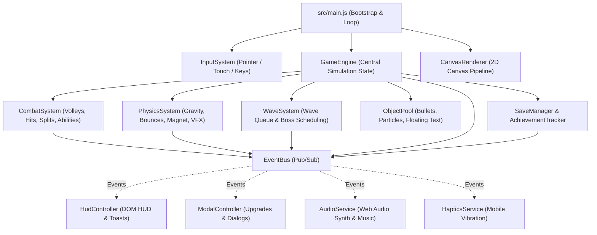

# Boulder Barrage

A free, non-commercial, browser-based arcade boulder-defense game built from scratch as a personal hobby & coding exercise using pure HTML5 Canvas, CSS3, and modular ES6 JavaScript (with procedural Web Audio API sound synthesis and zero external assets or runtime dependencies).

---

## Table of Contents

1. [Quick Start (Local Development)](#quick-start-local-development)
2. [Running Automated Unit Tests](#running-automated-unit-tests)
3. [How the Architecture Works](#how-the-architecture-works)
4. [Developer Guide: Extending the Game](#developer-guide-extending-the-game)
5. [End-to-End (E2E) GitHub & GitHub Pages Deployment](#end-to-end-e2e-github--github-pages-deployment)
6. [Legal, IP & Non-Commercial Status](#legal-ip--non-commercial-status)
7. [Progress Tracker](#progress-tracker)

---

## Quick Start (Local Development)

The modular source code under `src/` is bundled into `game.js` via a zero-dependency bundler (`scripts/bundle.js`) so it works both by opening `index.html` directly or over a local HTTP server:

```bash
# Bundle src/ -> game.js and run unit tests
npm test

# Start local HTTP server on port 8080
npm start
```

Then open `http://localhost:8080` in any modern desktop or mobile browser.

### Controls

- **Mouse / Touch**: Click/touch and drag horizontally anywhere—or use the **Underground Thumb Trackpad (`◀ DRAG THUMB HERE ▶`)** below the grass line on mobile so your thumb never blocks your cannon—to move and auto-fire.
- **Keyboard**: Use `◀` / `▶` (`ArrowLeft` / `ArrowRight`) to move, hold `Space` to fire, and press `P` or `Esc` to pause.
- **Lobby Controls**:
  - Use the **`◀` / `▶` Wave Stepper** on the Wave Pill to replay earlier waves for coin farming or jump back to your highest unlocked wave.
  - **Press and hold** any of the 4 Upgrade Cards to rapidly auto-buy upgrades while affordable.

---

## Running Automated Unit Tests

The test suite uses Node's built-in test runner (`node:test` and `node:assert`) with zero external npm dependencies:

```bash
npm test
# or directly:
node --test tests/*.test.js
```

---

## How the Architecture Works

### 1. High-Level Data & Event Flow

The codebase is split into **8 decoupled layers** under `src/`. Simulation systems (`WaveSystem`, `PhysicsSystem`, `CombatSystem`) never touch the DOM or Web Audio API directly—instead, they mutate entity state inside `GameEngine` and broadcast events over `EventBus`.



### 2. Directory Layout

```text
boulder-barrage/
├── index.html                  # Game shell, HUD overlay, upgrade cards, and 5-tab Hangar/Codex
├── style.css                   # Responsive 9:16 viewport styling, HUD pills, and animations
├── game.js                     # Bundled runtime generated from src/ via `npm run build`
├── scripts/
│   └── bundle.js               # Zero-dependency ES module -> IIFE bundler
├── manifest.webmanifest        # Mobile PWA / Add-to-Home-Screen manifest
├── .nojekyll                   # Bypass Jekyll on GitHub Pages for instant static serving
├── .github/workflows/
│   └── deploy.yml              # CI/CD pipeline: runs unit tests + deploys to GitHub Pages
├── src/
│   ├── main.js                 # App entry point wiring EventBus, Engine, Renderer & UI
│   ├── config/                 # Declarative data registries & balance constants
│   │   ├── constants.js        # Physics, gravity, bounce velocities, and save keys
│   │   ├── upgrades.js         # Upgrade tracks and cost/stat scaling parameters
│   │   ├── cannons.js          # 5 Unlockable Cannon Varieties (Chassis classes)
│   │   ├── addons.js           # 5 Unlockable Tactical Add-Ons
│   │   ├── skins.js            # 8 Unlockable Cannon Skins catalog
│   │   ├── themes.js           # 7 Unlockable Visual Arena Themes catalog
│   │   ├── augments.js         # 8 Stackable Tactical Run Augments ("Choose 1 of 3" draft)
│   │   ├── powerups.js         # 8 Distinct Power-Ups with orb tags & HUD descriptions
│   │   ├── rockVariants.js     # Declarative rock, barrel & boss variant rules + HP color tiers
│   │   └── achievements.js     # Lifetime achievements catalog & progress evaluators
│   ├── core/                   # Engine primitives
│   │   ├── EventBus.js         # Pub/Sub event emitter decoupling simulation from UI/Audio
│   │   ├── ObjectPool.js       # Reusable pool for particles, bullets & floating text
│   │   ├── GameEngine.js       # Central simulation coordinator & run lifecycle
│   │   └── utils.js            # Number formatting (formatNum) & math helpers
│   ├── state/                  # Persistence & progression math
│   │   ├── SaveManager.js      # LocalStorage persistence, schema migrations, offline calc
│   │   ├── UpgradeMath.js      # Pure stat calculation functions & milestone perks
│   │   └── AchievementTracker.js # Evaluates stats against achievement rules
│   ├── entities/               # Entity models & factories
│   │   ├── Cannon.js           # Player turret, movement smoothing, recoil & attachment slots
│   │   └── Rock.js             # Boulder factory, procedural polygon generator, cracks & variant state
│   ├── systems/                # Frame-by-frame simulation systems
│   │   ├── WaveSystem.js       # Wave generator, split-aware HP calculator & spawn timer
│   │   ├── PhysicsSystem.js    # Movement, gravity, wall/floor bounce, magnet pull
│   │   ├── CombatSystem.js     # Bullet collisions, armor break, rock split, boss skills, TNT/Geodes
│   │   └── InputSystem.js      # Pointer, touch, and keyboard input normalization
│   ├── render/                 # Graphics pipeline
│   │   └── CanvasRenderer.js   # Modular 2D canvas drawing (fracture cracks, sky, rocks, cannon, VFX)
│   ├── services/               # Hardware & browser capabilities
│   │   ├── AudioService.js     # Web Audio API synth SFX + background music loop
│   │   └── HapticsService.js   # Mobile navigator.vibrate wrapper
│   └── ui/                     # DOM overlays & modals
│       ├── HudController.js    # Top HUD, Hull shields, augment chips, wave/boss bars, toasts
│       └── ModalController.js  # Upgrades, Augment draft, Hangar/Themes, Stats, Settings, Game Over
└── tests/                      # Automated unit tests (node:test)
    ├── UpgradeMath.test.js     # Tests cost curves, barrel unlocks, milestones & offline caps
    ├── SaveManager.test.js     # Tests v1->v2 save migrations, catalogs & achievement rewards
    ├── WaveSystem.test.js      # Tests split HP accounting & boss wave scheduling
    └── HullAndAugments.test.js # Tests 3-segment Hull Shield integrity, invulnerability & augments
```

### 3. Frame Lifecycle (`src/main.js`)

Every animation frame (`requestAnimationFrame`):
1. **Delta Time Clamping**: `dt` is clamped to a maximum of `0.05s` (20 FPS floor) so tab-switching or backgrounding never causes rocks to tunnel through the floor.
2. **`GameEngine.update(dt, inputSystem)`**:
   - Ticks screen-shake, revive shield, and active power-up durations (`rapidFire`, `shield`, `magnet`, `freeze`).
   - Updates `Cannon` horizontal tracking and triggers `CombatSystem.fireVolley()` if firing.
   - Ticks `WaveSystem` to spawn queued boulders when simultaneous rock count is below the wave threshold.
   - Runs `CombatSystem.updateBullets()` for hit detection, armor reduction, rock splitting, and score updates.
   - Runs `PhysicsSystem` for boulder gravity (scaled by Cryo Freeze), wall/ground bounces, special abilities (`healer` pulse, `boss` surge, `milestoneBoss` meteor swarm / Aegis shield), coin magnetization, power-up orb collection, and pooled VFX recycling.
3. **`CanvasRenderer.render(now)`**:
   - Renders the active `ARENA_THEMES` sky gradient, twinkling stars, layered mountains, shockwaves, spinning coins, bobbing power-up orbs, bullets, faceted rocks, `CANNON_SKINS` turret, ground, particles, and floating text.

### 4. Key EventBus Events

| Event Name | Emitted By | Handled By | Payload Summary |
| :--- | :--- | :--- | :--- |
| `sfx:shoot` | `CombatSystem` | `AudioService` | `{ overdrive }` |
| `sfx:hit` | `CombatSystem`, `PhysicsSystem` | `AudioService` | `{ hpRatio, armored }` |
| `rock:destroyed` | `CombatSystem` | `AudioService`, `HapticsService` | `{ size, isBoss }` |
| `wave:updated` | `WaveSystem`, `CombatSystem` | `HudController` | `{ waveNum, damageDealt, totalHP }` |
| `wave:cleared` | `GameEngine` | `HudController`, `AudioService`, `HapticsService` | `{ clearedWave, isMilestone, waveBonus }` |
| `wave:milestoneAlert`| `WaveSystem` | `HudController`, `AudioService`, `HapticsService` | `{ waveNum }` |
| `powerup:collected` | `GameEngine` | `AudioService`, `HapticsService` | `{ type, meta }` |
| `powerup:updated` | `GameEngine` | `HudController` | `activePowerups` map |
| `achievement:unlocked`| `AchievementTracker`| `HudController`, `AudioService`, `HapticsService` | Achievement object |
| `run:gameover` | `GameEngine` | `ModalController`, `AudioService`, `HapticsService`| `{ wave, score, runCoins, usedRevive }` |

---

## Developer Guide: Extending the Game

- **Add a New Cannon Skin or Arena Theme**:
  Append a new object to `CANNON_SKINS` in `src/config/skins.js` or `ARENA_THEMES` in `src/config/themes.js` with an `isUnlocked(save)` predicate. The Hangar modal and renderer pick it up automatically.
- **Add a New Achievement**:
  Append an entry to `ACHIEVEMENTS` in `src/config/achievements.js` with `progress: (save) => [currentValue, targetValue]` and `reward`.
- **Add a New Rock Variant**:
  1. Define its multipliers and interval in `src/config/rockVariants.js`.
  2. Add its spawn probability in `pickRockVariant()` inside `src/systems/WaveSystem.js`.
  3. Add any custom ability effect in `CombatSystem.triggerRockSpecialAbility()`.

---

## End-to-End (E2E) GitHub & GitHub Pages Deployment

### Step 1: Push Your Code to GitHub

From the project root (`/Users/keerthan/MyWork/boulder-barrage`):

```bash
# Check status and stage all files
git status
git add .
git commit -m "Feat: Modular ES6 architecture, all backlog features, unit tests & GitHub Pages CI"

# Add your GitHub remote (if not already added) and push
git branch -M main
git remote add origin https://github.com/<your-username>/boulder-barrage.git
git push -u origin main
```

### Step 2: Enable GitHub Pages (Two Options)

#### Option A: Automated CI/CD with Unit Test Gate (Recommended)
This repository includes `.github/workflows/deploy.yml`, which automatically checks syntax, runs `npm test`, and deploys to GitHub Pages on every push to `main`:
1. On GitHub, open your repository → **Settings → Pages**.
2. Under **Build and deployment → Source**, select **GitHub Actions**.
3. Push to `main` (or trigger the workflow from the **Actions** tab). Once the **Test & Deploy to GitHub Pages** workflow turns green, your game will be live at:
   `https://<your-username>.github.io/boulder-barrage/`

#### Option B: Direct Branch Deployment (Zero-Action)
Because the project uses native ES modules with relative paths (`./src/main.js`) and includes a `.nojekyll` file, GitHub Pages can also serve the branch directly without any build workflow:
1. Go to **Settings → Pages**.
2. Under **Source**, choose **Deploy from a branch**.
3. Select branch `main` and folder `/ (root)`, then click **Save**.

### Step 3: Install on Your Phone (Full-Screen Mobile App Mode)

1. Open `https://<your-username>.github.io/boulder-barrage/` on your phone.
2. **On iPhone (Safari)**: Tap the **Share** button (`↑`) at the bottom → scroll down and tap **Add to Home Screen**.
3. **On Android (Chrome)**: Tap the `⋮` menu → tap **Add to Home screen** or **Install app**.
4. Launch **Boulder Barrage** from your home screen—thanks to `manifest.webmanifest` and the mobile viewport meta tags in `index.html`, it runs in standalone full-screen portrait mode with touch-drag controls and mobile haptic vibration.

---

## Legal, IP & Non-Commercial Status

- **Original Code & Procedural Assets**: 100% of the code, vector shapes (HTML5 Canvas primitives), and sound effects/music (Web Audio API oscillators) are original and generated procedurally at runtime. No third-party sprites, audio files, fonts, or proprietary assets are used.
- **No Trademark Affiliation**: This project uses the original title **Boulder Barrage** and is not affiliated with, endorsed by, or connected to any commercial mobile game publisher.
- **Strictly Free & Non-Commercial (Personal Educational & Portfolio Project)**:
  - **Zero Monetization**: This software is developed and hosted solely as a personal, unpaid coding and educational exercise. It generates **zero revenue** and contains no advertisements, no in-app purchases, no paywalls, no sponsorships, no subscriptions, and no donation or tip links of any kind. Operating or sharing this personal educational and portfolio project does not constitute commercial business activity or employment.
  - **Local-Only Data**: Game progress is stored strictly in the user's browser via `localStorage` (`boulder_barrage_save_v1`) with no backend servers, user accounts, or tracking/analytics.

---

## Progress Tracker

### Completed Features
- [x] **IP & Non-Commercial Cleanliness**
  - [x] Rebranded to original title (**Boulder Barrage**) and removed third-party trademark references
  - [x] 100% procedural graphics (Canvas 2D) and audio (Web Audio API) — zero external copyrighted assets
  - [x] Strictly free, ad-free, offline-capable local hobby build
- [x] **Modular ES6 Architecture, CI/CD & Automated Tests**
  - [x] Decoupled `config/`, `core/`, `state/`, `entities/`, `systems/`, `render/`, `services/`, and `ui/` modules
  - [x] Pub/Sub `EventBus` and `ObjectPool` for zero-GC-spike performance
  - [x] GitHub Pages CI workflow (`.github/workflows/deploy.yml`) & Mobile Web App (`manifest.webmanifest`, `.nojekyll`)
  - [x] Automated unit test suite (`node --test`)
- [x] **Core Cannon, Tactical Add-Ons & Combat Systems**
  - [x] Smooth horizontal cannon movement with rotating wheels, recoil, and muzzle flash
  - [x] **3-Segment Hull Shield Integrity (`🛡️🛡️🛡️`)**: Replaces frustrating instant-death with a 3-hit hull buffer per wave (`maxHull: 3-4`), granting a 1.35s mercy invulnerability repulse on contact and full shield repair between waves
  - [x] Underground **Thumb Trackpad Zone (`◀ DRAG THUMB HERE ▶`)** during active gameplay so mobile players never cover their cannon with their thumb
  - [x] Per-boulder randomized bounce heights and desynchronized split arcs so waves never bounce in lockstep
  - [x] Multi-barrel volley firing (unlocks 2, 3, and 4 barrels at higher Fire Rate levels)
  - [x] **Combo Streak Multiplier & Critical Hits (`💥 CRIT!`)** up to 2.5x score multiplier
  - [x] **Boss Rush Mode (`👑 2x 🪙`)** unlocked at Wave 6 for back-to-back Boss & Titan waves
  - [x] **Lobby Wave Stepper (`◀ WAVE X ▶`)** to replay/farm any cleared wave and jump back to `highestWave`
  - [x] **Spawn-Edge Warning Indicators** (`0.65s` before a boulder enters) & **0.38s Slow-Motion Fatal Hit** impact feedback
  - [x] In-game **Pause Modal (`⏸️`)** and automatic between-wave upgrade breather
- [x] **Rocks, Special Variants & Wave Progression**
  - [x] Faceted polygon boulders with dynamic HP color tiers and smooth piecewise Wave 25+ HP & coin scaling
  - [x] **Progressive Fracture Cracks & Rock Debris**: Render visible jagged internal stress fissures when boulders fall below 65% and 30% HP, accompanied by physical rock debris particle shedding
  - [x] **Interactive Sky Targets**:
    - **TNT Barrels (`🧨`)**: Volatile red explosive barrels that detonate in a 180px shockwave dealing massive AoE damage to surrounding boulders
    - **Golden Geodes (`💎`)**: Rare crystalline targets that burst into an 8-coin jackpot shower and drop a guaranteed tactical Power-Up orb
  - [x] Rock splitting mechanics (Large → 2 Medium → 4 Small)
  - [x] Additional enemy/rock types: **Armored Rocks** (🛡️ 40% damage reduction above 50% HP), **Fast Meteor Rocks** (☄️ high horizontal speed, low bounce), and **Healer Crystal Rocks** (💚 periodic healing pulse to nearby rocks)
  - [x] Boss rocks every 3 waves with gravity surge ability + dedicated Boss HP bar
  - [x] **Milestone Mega-Boss Waves** every 10 waves with **Titan Aegis Shield** and **Meteor Swarm** summons
  - [x] Real-time wave progress bar tracking total wave HP
  - [x] Wave clear banner and bonus coin rewards
- [x] **Tactical Augment Draft ("Choose 1 of 3" on Boss Waves)**
  - [x] In-run perk draft modal (`#augment-modal`) offered after conquering each Boss wave (every 3 waves or Boss Rush)
  - [x] 8 stackable tactical run augments with active combat HUD pills:
    - **Chain Volt (`🌩️`)**: Critical hits zap nearby boulders for 75% lightning damage
    - **Bank Shot (`🔱`)**: All cannon shots ricochet off arena side walls (+1 wall bounce)
    - **Permafrost Aura (`❄️`)**: Spawns every boulder chilled for 2.5s (+25% shatter damage)
    - **Shrapnel Core (`💥`)**: Crushed boulders fire 2 upward kinetic shrapnel bolts into the sky
    - **Deadeye Optics (`🎯`)**: +15% Critical Hit Chance and +0.4x Critical Damage multiplier
    - **Hyper Loader (`⚡`)**: +25% Fire Rate boost applied across all cannon weapons
    - **Aegis Hull +1 (`🛡️`)**: Permanently adds +1 Hull Shield slot and fully repairs all shields
    - **Midas Bounty (`💰`)**: +35% Coin Value & +8% Power-Up Orb drop chance
- [x] **8 Visually & Mechanically Distinct Power-Ups (With On-Canvas Tags & Codex)**
  - [x] **Overdrive (`2x SPEED`)**: ⚡ 1.85x Fire Rate firing twin electric cyan hyper-tracer needles
  - [x] **Ricochet Fan (`BOUNCE`)**: 🔱 Spinning 4-point star blades that ricochet off the left and right arena walls
  - [x] **Blast Shells (`CLUSTER`)**: 💣 Heavy mortar bombs that detonate into a fiery blast ring + 3 cluster shrapnel sparks
  - [x] **Pierce Beam (`LASER`)**: 🔦 Instant full-column neon magenta laser lances slicing straight from barrel to ceiling
  - [x] **Saw Calibre (`SAW 2X`)**: 🔥 Rotating fiery serrated sawblades (`2x DMG`) that instantly shred `🛡️ Armored` shells on contact
  - [x] **Plasma Dome (`SHIELD`)**: 🛡️ Emerald energy dome that zaps touching boulders for `3.2x DMG` while repelling them upward
  - [x] **Magnet Vortex (`2x COINS`)**: 🧲 Rotating golden gravity ring around the cannon with full-screen pull + 1.5x coin value
  - [x] **Cryo Blizzard (`FROST`)**: ❄️ Drifting snow crystals, 55% boulder slow, and +25% brittle shatter damage
- [x] **Economy, Upgrades & Persistence**
  - [x] Physical coin drops with floor bounce, wave-scaled coin values, and magnetic pull toward the cannon
  - [x] 4 upgrade tracks (**Fire Rate**, **Fire Power**, **Coins Multiplier**, **Offline Earnings**) positioned cleanly inside the underground foundation with **Press-and-Hold Auto-Upgrade**
  - [x] **Visible Upgrade Milestone Evolution Perks**: Real milestone indicators on each upgrade card:
    - **Fire Rate**: `Lv.4: 2 Barrels`, `Lv.9: 3 Barrels`, `Lv.15: 4 Barrels`, `Lv.25: Auto-Laser`
    - **Fire Power**: `Lv.10: +45% Exec` (Executioner bonus to rocks < 35% HP), `Lv.20: AoE Blast`, `Lv.30: 2x vs Armor`
    - **Coin Value**: `Lv.10: +Geodes` (boosts Golden Geode spawn rate), `Lv.20: 2x Boss Coins`, `Lv.30: +Magnet`
    - **Offline Earnings**: `Lv.10: +1 Hull 🛡️` (+1 maximum Hull Shield), `Lv.20: +25% Power-Up Duration`
  - [x] `localStorage` auto-save with schema migration and two-step inline progress reset in Settings
  - [x] Offline earnings calculation and claim modal on return
- [x] **5-Tab Hangar & Codex (Cannons, Add-Ons, Skins, Arenas & Guide)**
  - [x] **Gear Unlock Toasts (`🔓 NEW GEAR UNLOCKED!`)** and pulsing notification badge (`#hangar-notif-dot`) when new gear unlocks
  - [x] **5 Cannon Varieties (Chassis)**: **Vulcan Striker**, **Scatter Flak** (+2 fan spread barrels), **Heavy Railgun** (2.4x DMG piercing slugs), **Plasma Gatling** (1.55x fire rate + crit), and **Siege Blast** (area splash mortar)
  - [x] **5 Tactical Add-Ons**: **Wingman Drones** (🛸 homing plasma pods), **Holo-Scope Sight** (🎯 +18% crit chance & +0.5x crit DMG), **Bumper Buzzsaw** (⚙️ parries & slices low boulders), **Arc Tesla Pylon** (🌩️ chain lightning zaps), and **Sub-Zero Bumper** (❄️ floor bounces chill & damage rocks)
  - [x] **8 Cannon Skins**: *Classic Azure*, *Crimson Vanguard*, *Emerald Viper*, *Golden Sovereign*, *Solar Flare*, *Cyber Neon*, *Void Obsidian*, and *Starlight Prism*
  - [x] **7 Visual Arena Themes**: *Midnight Peaks*, *Ember Canyon*, *Bio-Lab Reactor*, *Frostbite Tundra*, *Synthwave Grid*, *Magma Caldera*, and *Deep Nebula*
  - [x] **Codex Tab (`📖 Codex`)**: Full visual reference for all 8 Power-Up Orbs and Special Boulder Types
- [x] **Stats, Achievements, Controls & Audio**
  - [x] Lifetime stats dashboard & 10 milestone achievements with live progress bars, coin rewards, and unlock toasts
  - [x] Pointer/touch drag controls + Keyboard (`ArrowLeft`, `ArrowRight`, `Space`, `P`/`Esc`) support
  - [x] Zero-asset Web Audio API SFX & procedural synthwave background music with independent **SFX Volume** and **Music Volume** sliders
  - [x] Mobile **Haptic Feedback** supporting both Android (`navigator.vibrate`) and iOS 18+ Safari (`<input type="checkbox" switch>` Taptic Engine)
  - [x] Screen shake, shockwave rings, particle bursts, floating popups, and "Second Wind" free revive shield
